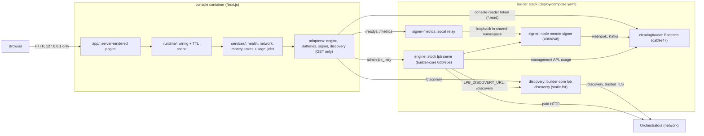
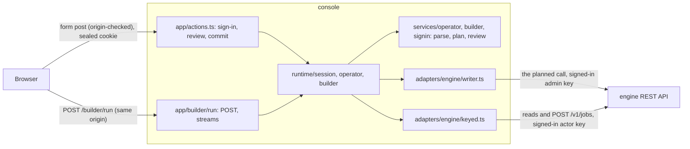

# Architecture

The console sits beside a running builder stack. Its pages read it and answer **is the stack healthy,
where did the money go, and who used it**; they change nothing (D1). Two areas change it, each behind
a sign-in with an engine key (D15, D16): **Operator actions** (admin key: grants, actors, keys) and
the **Builder** (actor key: catalog, jobs, results, cost). They are described under
[Writing areas](#writing-areas-d15d20).

The engine, Batteries and signer are the same components, pins and configuration ChatLPT runs
([payment-stack.md](docs/references/payment-stack.md)). The difference: here the engine is a separate
service built from builder-core, not embedded in an app (decision D2).

## Layers

Code depends only "forward". `web/tests/structure/layers.test.ts` enforces every edge and prints how
to fix a violation.

| Layer | Folder | May import | Notes |
| --- | --- | --- | --- |
| Utils | `utils/` | nothing internal | decimals, time, concurrency |
| Types | `domain/` | utils | zod schemas, engine types, view models, pins, gaps, catalog |
| Providers | `ports/` | domain | `EngineReader`, `BatteriesReader`, `SignerReader`: read methods only |
| Config | `config/` | domain | `CONSOLE_*` settings; server-only |
| Adapters | `adapters/` | domain, ports, config, utils | HTTP implementations of the ports; server-only |
| Service | `services/` | domain, ports, utils | pure functions over `Sources`; all page logic and its tests |
| App wiring | `runtime/` | everything above | builds readers once per process, caches, exposes `load*()`; server-only |
| UI kit | `components/ui/` | nothing internal | shadcn components as generated |
| UI | `components/console/` | domain, utils, UI kit | semantic value renderers, sections, tables |
| Routes | `app/` | runtime, UI, UI kit, domain, services, utils | one server component per page |

Services never touch HTTP: they receive the readers from the runtime, so every service test runs on
fixtures copied from a live stack (`web/tests/support/fixtures.ts`).

## Third-party boundaries

| Package | Only in |
| --- | --- |
| `openapi-fetch` | `adapters/` (engine) |
| `zod` | `domain/` |
| `radix-ui`, `class-variance-authority`, `cn` | `components/ui/` |
| `next`, `react` | `app/`, `components/` |
| Gyral (any `@gyral/*`) | nowhere (D4) |

## Reads, failures and caching

- Every adapter method returns a `Reading<T>`: the value, or the source and the problem
  (`not_configured`, `unreachable`, `http`, `unexpected`). Nothing throws past an adapter, so one
  down component never blanks a page.
- Pages render a static shell and stream each section's data inside `<Suspense>`
  (Next.js Cache Components). Nothing about the stack is prerendered.
- `runtime/ttl-cache.ts` reuses each upstream read for `CONSOLE_CACHE_TTL_S` (15 s) and shares
  in-flight reads. Nothing is persisted (D6).
- Batteries lists are walked page by page up to `CONSOLE_MAX_LIST_ROWS`; a capped list is marked
  `truncated` and pages say their totals are partial ([gap G6](docs/references/gaps.md)).

## Domains

| Page | Service | Spec |
| --- | --- | --- |
| Health | `services/stack-health.ts` | [console.md#health](docs/product-specs/console.md#health) |
| Network | `services/network.ts` | [console.md#network](docs/product-specs/console.md#network) |
| Money | `services/money.ts` | [console.md#money](docs/product-specs/console.md#money) |
| Users | `services/users.ts` | [console.md#users](docs/product-specs/console.md#users) |
| Usage | `services/usage.ts` | [console.md#usage](docs/product-specs/console.md#usage) |
| Jobs | `services/jobs.ts` | [console.md#jobs](docs/product-specs/console.md#jobs) |
| Sources and gaps | `domain/catalog.ts`, `domain/gaps.ts` | [data-sources.md](docs/references/data-sources.md), [gaps.md](docs/references/gaps.md) |
| Operator actions | `services/operator.ts`, `runtime/operator.ts` | [console.md#operator-actions](docs/product-specs/console.md#operator-actions) |
| Builder | `services/builder.ts`, `runtime/builder.ts` | [console.md#builder](docs/product-specs/console.md#builder) |

## Writing areas (D15–D20)

- **One plan, shown then sent.** `domain/operator.ts` turns a parsed action into the exact engine call
  (`callOf`). The review step shows that call; the commit sends it unchanged through the writer. The
  Builder's run is built the same way (`domain/builder.ts`, `jobRequestOf`) in the browser for the
  preview and parsed again on the server (`services/builder.ts`, `parseRun`) before it is sent.
- **The signed-in key, never the console's.** `runtime/session.ts` seals the pasted key into the area's
  cookie and builds a keyed engine from it per request; the console's own admin key stays on the read
  path. Writes clear the shared read cache so the pages show the change.
- **Results stay on screen.** An Operator dialog refreshes the page only when it closes, so an action
  that changes a row's buttons cannot unmount the result it is showing.
- **Enforced** by `web/tests/structure/writes.test.ts`: write methods only in the two adapters, built
  only by their runtime modules, server actions only in `app/actions.ts`, POST handlers only in the
  Builder, posting forms only in the writing areas, and no read-only page importing a write path.
